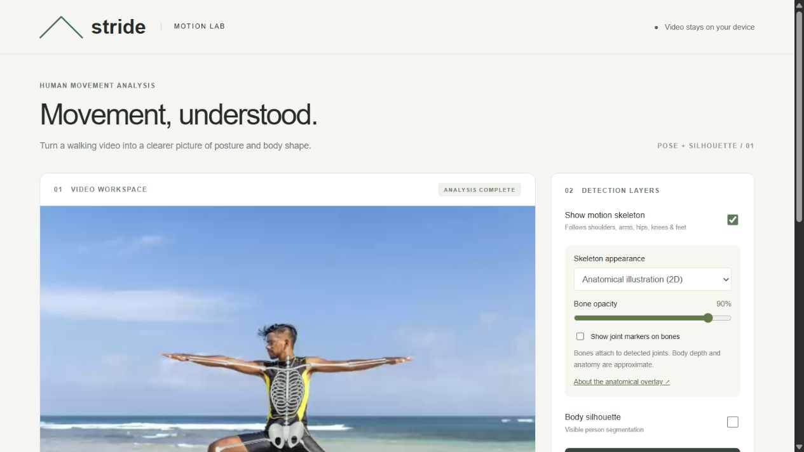

# Mia — Posture Estimation

Mia analyzes a walking video locally and overlays detected joints or an anatomical skeleton illustration. It runs in a browser and can be packaged as a standalone Windows executable.



*Anatomical overlay preview. This screenshot shows the earlier Stride branding; the app is now named Mia.*

## Features

- Single-person detection with MediaPipe Pose Landmarker Heavy.
- 30 samples per second with interpolated playback.
- Anatomical illustration or landmark lines, skeleton on/off, joint markers, and adjustable opacity.
- Visible-person silhouette segmentation.
- Estimated 2D knee angles, torso tilt, and landmark visibility.
- Timestamped JSON export, including raw landmarks, and annotated PNG frames.
- Offline operation after dependency setup or when using the built executable.

Videos stay in browser memory and are not uploaded. Refreshing the page clears results.

## Run from source

Install Node.js 18 or newer, then run from the repository directory:

```sh
npm run setup
npm start
```

Open **http://127.0.0.1:4188** in Chrome or Edge. Setup downloads pinned runtime/model files and verifies SHA-256 checksums. Large downloaded dependencies are excluded from Git.

## Build Mia.exe on Windows

After running setup:

```powershell
npm run build:windows
```

The build uses the Windows .NET Framework C# compiler and writes **build/Mia.exe**, embedding the interface, runtime and model. The executable needs no Node.js installation. Launch it and keep its small window open while using the browser app. Close the launcher to stop its localhost server. The executable is unsigned.

## Use

1. Choose a browser-supported video up to two minutes long, with one person's full body visible.
2. With Skeleton ON, analysis starts automatically. Wait for completion, then play or scrub.
3. Select Anatomical illustration (2D) or Joint lines & dots; adjust opacity or silhouette as needed.
4. Export landmark data or the current annotated frame.

## Accuracy and limits

Results depend on lighting, clothing, perspective, occlusion and motion blur. Joints below 0.65 visibility or outside the image are hidden. Visibility is not an accuracy percentage. Sampling at 30 Hz cannot add image detail to lower-frame-rate footage. The anatomical overlay is a custom approximate 2D illustration, not a scan or patient-specific 3D model. Metrics are not clinical assessments.

The current model and flow were functionally checked using a short video of a public person-image fixture. No quantitative walking-gait accuracy benchmark has been performed. The Windows launcher passed embedded-file checks.

## Source layout

- `dist/`: interface, detection, skeleton drawing and playback.
- `src/MiaLauncher.cs`: Windows launcher and localhost asset server.
- `scripts/setup.mjs`, `scripts/dependencies.json`: pinned downloads and integrity checks.
- `scripts/build-windows.ps1`: standalone executable build.
- `server.cjs`: development server.

## Third-party dependencies

Google MediaPipe Tasks Vision **0.10.21** and Pose Landmarker Heavy are downloaded from jsDelivr/Google using the dependency manifest. MediaPipe's Apache 2.0 license is included in `licenses/MediaPipe-LICENSE.txt`. See [Google's model documentation](https://ai.google.dev/edge/mediapipe/solutions/vision/pose_landmarker).

The current anatomical renderer uses custom canvas geometry and does not require the earlier emoji artwork. Source is provided without an additional project-wide license grant.
